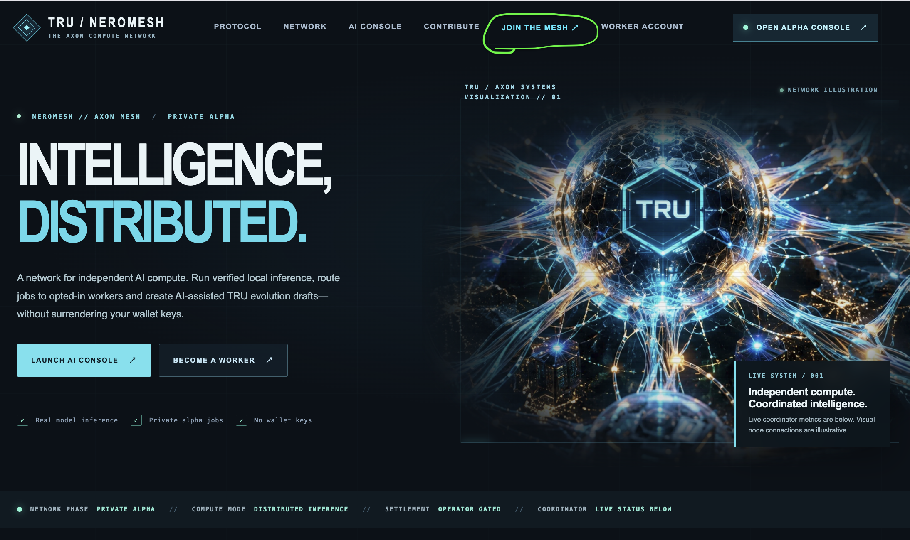
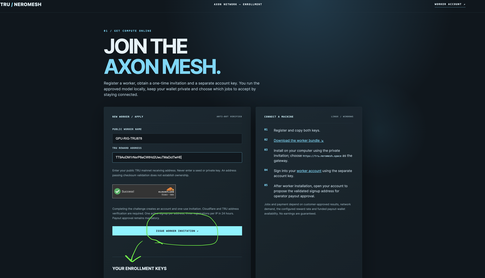
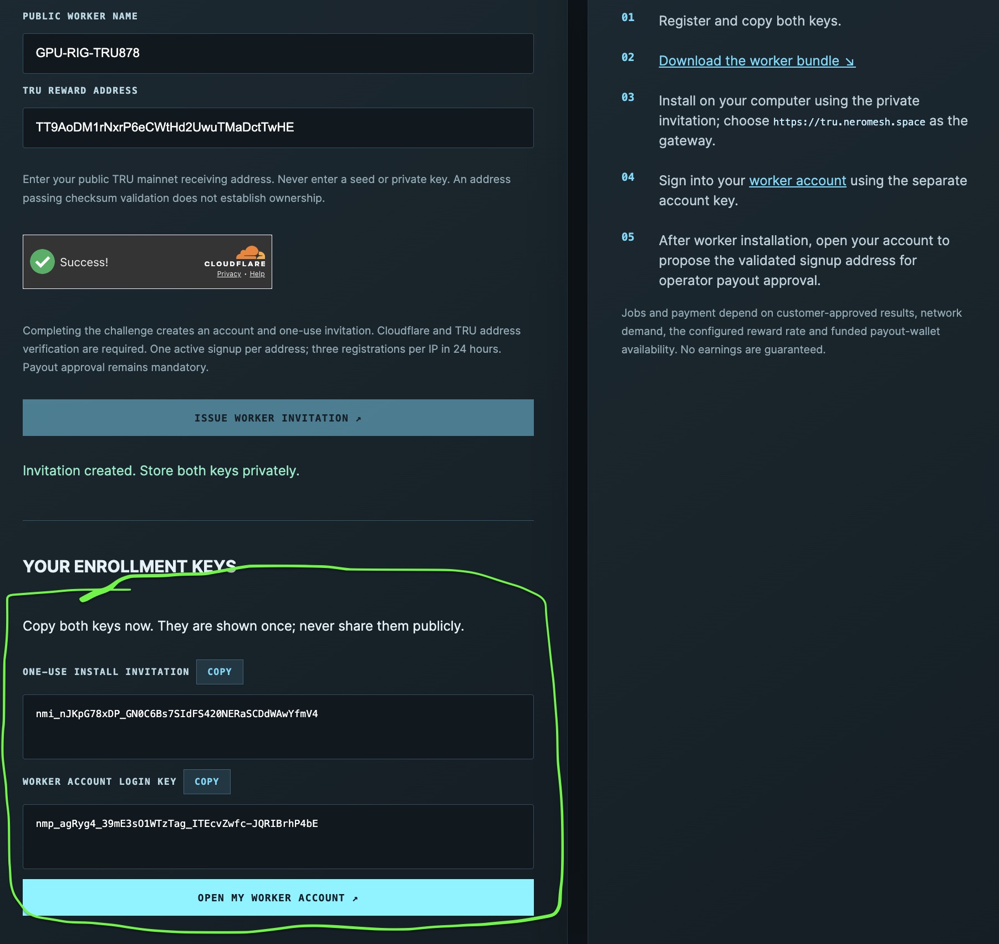
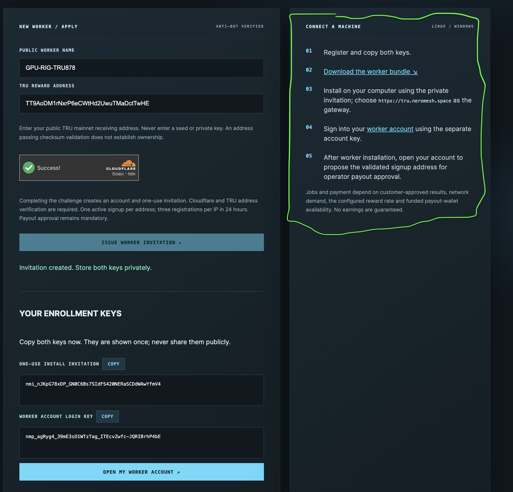
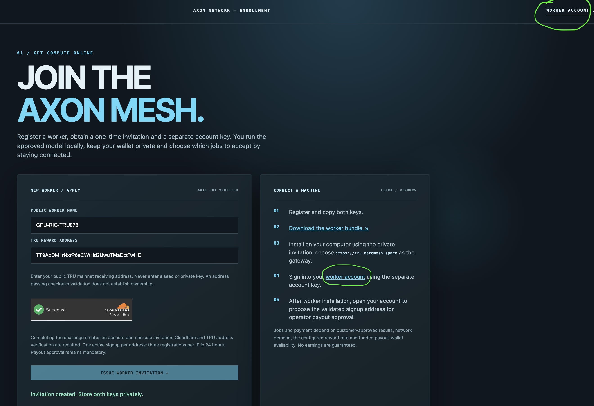
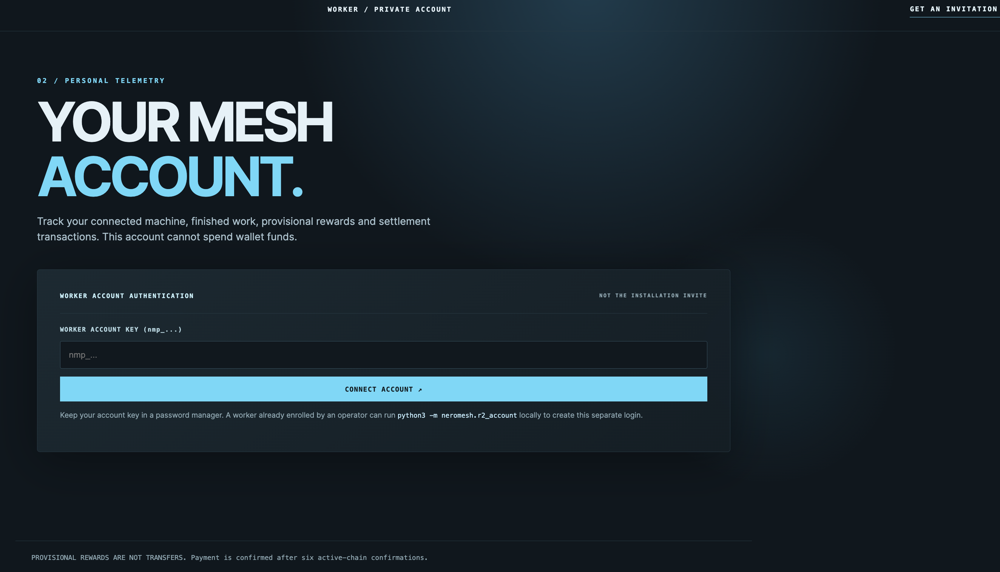
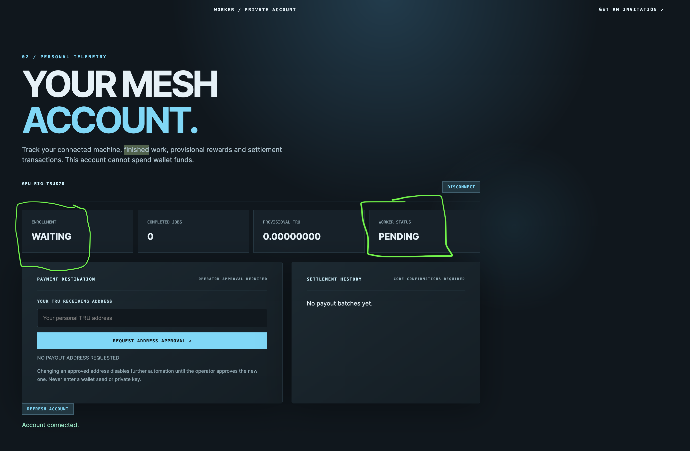
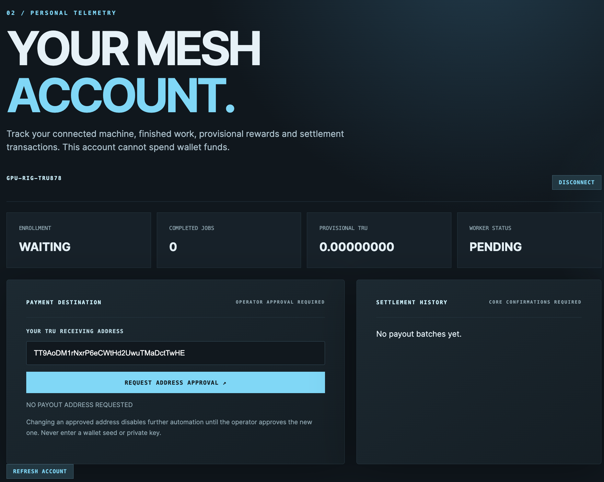
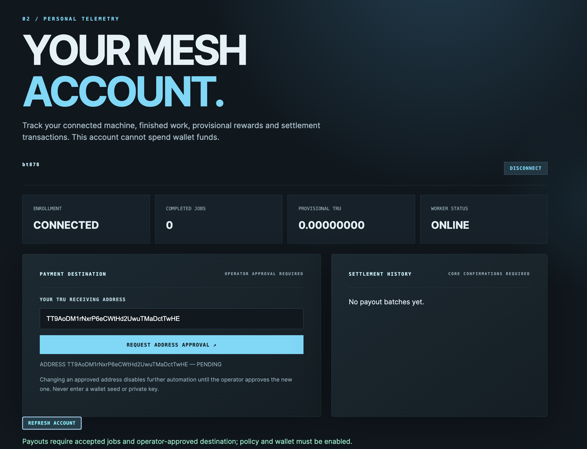

# NEROMESH Worker Quick Start

NEROMESH allows you to connect your own computer to the **TRU / Axon distributed AI compute network**.

Your machine runs approved AI workloads locally while remaining under your control.

This guide walks through registering a worker, installing the NEROMESH Worker Bundle, connecting your machine, and setting your TRU payout address.

> **Important**
>
> - Never enter or share your TRU wallet seed phrase or private key.
> - NEROMESH only needs your **public TRU receiving address**.
> - Keep your NEROMESH enrollment and account keys private.
> - This guide currently covers the Linux worker installer.

---

# Step 1 — Open NEROMESH

Go to:

**https://tru.neromesh.space**

At the top of the page, click:

**JOIN THE MESH**



---

# Step 2 — Register Your Worker

Enter a name for your computer in:

**PUBLIC WORKER NAME**

Example:

```text
GPU-RIG-TRU878
```

Then enter your **public TRU receiving address**.

Example:

```text
TT...
```

This is the TRU address where you want approved NEROMESH payouts to eventually be sent.

**Never enter a wallet seed phrase or private key.**

Complete the Cloudflare verification and click:

**ISSUE WORKER INVITATION**



---

# Step 3 — Save Your Worker Credentials

After your registration is accepted, NEROMESH will display two separate credentials.



You will receive:

### One-Use Install Invitation

It begins with:

```text
nmi_
```

This key is used **one time** when installing the worker on your computer.

### Worker Account Login Key

It begins with:

```text
nmp_
```

This key is used to sign in to your private **Worker Account** on the NEROMESH website.

## Keep both keys private.

They serve different purposes:

```text
nmi_... = Worker installation / machine enrollment

nmp_... = NEROMESH Worker Account login
```

Do not post either key publicly.

The installer will ask for your `nmi_` invitation privately. You should not place the invitation directly into a public command or script.

---

# Step 4 — Download the Worker Bundle

On the right side of the registration page, click:

**Download the worker bundle**



The downloaded ZIP file contains the NEROMESH worker software and installer.

---

# Step 5 — Extract the Worker Bundle

Extract the downloaded ZIP file.

After extraction you should have a directory named:

```text
neromesh-worker-bundle
```

For example, if the file was downloaded into your Linux `Downloads` folder:

```bash
cd ~/Downloads
unzip neromesh-worker-bundle.zip
cd neromesh-worker-bundle
```

If you extracted the ZIP using your desktop file manager, simply open a terminal inside the resulting:

```text
neromesh-worker-bundle
```

directory.

---

# Step 6 — Install the NEROMESH Worker

From inside `neromesh-worker-bundle`, run:

```bash
bash install/worker-linux.sh \
  --gateway https://tru.neromesh.space \
  --accept-model-license \
  --start
```

NEROMESH uses the public gateway:

```text
https://tru.neromesh.space
```

You do **not** need to enter an IP address or configure network ports.

The installer will ask you for your:

```text
nmi_...
```

**One-Use Install Invitation.**

Paste the invitation when requested.

The invitation is entered privately and is not echoed back to the terminal.

> Do not use your `nmp_` Worker Account Login Key here.
>
> The installer requires the `nmi_` installation invitation.

---

# Model License

The standard NEROMESH worker package uses the approved Qwen model.

The installer requires explicit acceptance of the model license.

That is why the installation command contains:

```text
--accept-model-license
```

Model information:

**Qwen2.5-0.5B-Instruct-GGUF — Apache-2.0**

https://huggingface.co/Qwen/Qwen2.5-0.5B-Instruct-GGUF

---

# Step 7 — Open Your Worker Account

Return to:

**https://tru.neromesh.space**

You can reach the Worker Account in several ways.

From the enrollment page, click:

**OPEN MY WORKER ACCOUNT**



You can also click:

**WORKER ACCOUNT**

at the top of the NEROMESH website.



Enter the:

```text
nmp_...
```

**Worker Account Login Key** that you saved during registration.

This key gives you access to your NEROMESH worker information.

It is separate from your TRU wallet and **cannot spend your TRU wallet funds**.

---

# Step 8 — Check Worker Enrollment

Before the NEROMESH worker has been installed, your account may show:

```text
ENROLLMENT
WAITING
```

and:

```text
WORKER STATUS
PENDING
```



This is normal.

The website registration has been created, but the actual machine has not yet redeemed its one-use invitation and connected to NEROMESH.

After the worker installation completes and the machine connects successfully, the account should progress to the connected worker state.

A connected worker should ultimately show:

```text
ENROLLMENT
CONNECTED
```

and:

```text
WORKER STATUS
ONLINE
```

The worker must remain running and connected for the site to report it as online.

---

# Step 9 — Set Your Payout Address

**Install and connect your worker before requesting payout-address approval.**

Once your worker has been installed, open your Worker Account and locate:

**PAYMENT DESTINATION**

Enter your public TRU receiving address.



Then click:

**REQUEST ADDRESS APPROVAL**

The address is submitted for operator approval.

Never enter:

- A wallet seed phrase
- A private key
- A wallet backup
- Any credential capable of spending your TRU

NEROMESH only needs your **public TRU receiving address**.

Changing an approved payout address may require another operator approval before automated settlement can continue.

---

# Step 10 — Verify Your Worker

You can check your local NEROMESH worker from the terminal.

Run:

```bash
cd ~/.local/share/neromesh-worker
python3 -m neromesh.worker status
```

A successfully enrolled worker will report information about the registered machine and its current worker state.

You can also return to your Worker Account and click:

**REFRESH ACCOUNT**

to see the latest information reported by your machine.

---

# Starting the Worker Manually

If you installed without automatically starting the worker, it can be started with:

```bash
~/.local/share/neromesh-worker/run-worker.sh
```

When the worker is running it maintains its connection to the NEROMESH gateway and can receive approved jobs.

Press:

```text
Ctrl+C
```

to stop a worker that is running directly in the terminal.

---

# NVIDIA / CUDA Workers

NEROMESH also supports CUDA-enabled NVIDIA workers.

Only use CUDA mode if NVIDIA CUDA is already correctly installed on your computer.

Before attempting CUDA mode, these commands should work:

```bash
nvidia-smi
nvcc --version
```

A CUDA installation can then use:

```bash
bash install/worker-linux.sh \
  --gateway https://tru.neromesh.space \
  --accept-model-license \
  --cuda \
  --start
```

The installer will again request your private `nmi_` installation invitation.

---

# Understanding Your NEROMESH Keys

There are three completely different pieces of information involved in NEROMESH:

| Item | Example Prefix | Purpose |
|---|---|---|
| TRU Receiving Address | `TT...` | Receives approved TRU payouts |
| Install Invitation | `nmi_...` | Enrolls one machine |
| Worker Account Key | `nmp_...` | Signs into your private Worker Account |

**Never confuse your NEROMESH credentials with your TRU wallet private keys.**

NEROMESH does not require your wallet private key.

---

# Installation Overview

The entire process is:

```text
Visit tru.neromesh.space
          │
          ▼
     JOIN THE MESH
          │
          ▼
Enter Worker Name + Public TRU Address
          │
          ▼
Complete Cloudflare Verification
          │
          ▼
Issue Worker Invitation
          │
          ├── nmi_...  → Machine installation
          │
          └── nmp_...  → Worker Account login
          │
          ▼
Download Worker Bundle
          │
          ▼
Extract neromesh-worker-bundle
          │
          ▼
Run Worker Installer
          │
          ▼
Enter nmi_ Invitation
          │
          ▼
Worker Enrolls with NEROMESH
          │
          ▼
Worker Connects
          │
          ▼
Sign Into Worker Account with nmp_ Key
          │
          ▼
Request TRU Payout Address Approval
          │
          ▼
NEROMESH Worker Ready
```

---

# Security

Your NEROMESH Worker Account is intentionally separated from your TRU wallet.

NEROMESH workers do not need custody of your wallet keys.

Keep these items private:

```text
nmi_... installation invitations
nmp_... account keys
~/.config/neromesh/worker.json
```

The local worker configuration contains machine credentials and should not be uploaded to GitHub, posted in screenshots, or shared with another user.

Your public TRU receiving address is safe to provide to NEROMESH for payment purposes.

---

# Need to Check Your Worker?

From the worker computer:

```bash
cd ~/.local/share/neromesh-worker
python3 -m neromesh.worker status
```

Then check your Worker Account at:

**https://tru.neromesh.space**

Your machine should report periodically while the NEROMESH worker is running.

---

**TRU / NEROMESH**

**The Axon Compute Network**

Independent compute. Coordinated intelligence.

